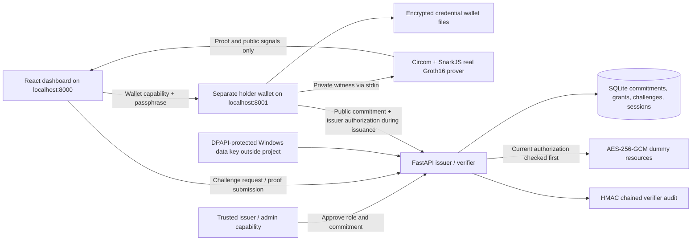

# Veil — privacy-preserving identity verification

For the later Render deployment variant, see [CLOUD_DEPLOYMENT.md](CLOUD_DEPLOYMENT.md).
It adds a browser wallet and Docker configuration while preserving the local
Python holder workflow described below. The PDF report and presentation describe
the original local implementation, not the later browser-wallet storage format.

A local final-year research prototype using React/Vite, FastAPI, SQLite, Circom, Poseidon, real SnarkJS Groth16 proofs, AES-256-GCM and HMAC audit chains. It supports healthcare, university, corporate and event/assembly demonstrations through one circuit and authorization architecture.

**Research prototype, not production identity infrastructure.** A trusted issuer establishes identity/eligibility outside the proof. A proof establishes possession of a registered private credential. It does not prove civil identity by itself.

## Quick start on Windows PowerShell

The implementation is in `C:\Users\siddh\Downloads\Project`. Node 24 and Python 3.10+ are required. A local `.venv`, compiled artifacts and frontend build have been created during implementation.

```powershell
Set-Location 'C:\Users\siddh\Downloads\Project'
.\start.ps1 -SkipBuild
```

Open http://127.0.0.1:8000. Startup creates a private `.env` file on the first run and loads its values on later runs. Open that file locally and use `ZKP_ADMIN_TOKEN` and `ZKP_WALLET_TOKEN` in the masked dashboard fields, then click **Connect / refresh**. Startup does not print secrets. These are administrator/service capabilities, not private ZKP credentials. Ctrl+C stops the services.

Keep `.env` private: it is excluded from Git, the deployment ZIP and Docker. The existing Windows DPAPI data key is preserved when migrating to `.env`; do not replace `ZKP_DATA_KEY` for an existing registry. Back up the file securely. The local starter requires `ZKP_CLOUD=0`; the previously supplied cloud `.env` uses `ZKP_CLOUD=1` and must not replace this local file. On Render, use the service's **Environment** settings instead; the Blueprint already generates server secrets. Never expose these values through `VITE_*` variables or frontend code. The demo administrator still enters an admin token in their own browser; environment storage does not replace administrator authentication.

If PowerShell blocks a local script, inspect it first and, if appropriate for your machine, run that invocation through `powershell.exe -ExecutionPolicy Bypass -File .\start.ps1 -SkipBuild`. This does not change the machine execution policy permanently.

### Fresh installation

```powershell
Set-Location 'C:\Users\siddh\Downloads\Project'
.\setup.ps1
.\start.ps1
```

Equivalent explicit commands:

```powershell
python -m venv .venv
.\.venv\Scripts\python.exe -m pip install -r requirements.txt
npm.cmd ci
npm.cmd run setup:zk
npm.cmd run build
.\start.ps1 -SkipBuild
```

Use `npm.cmd` and `npx.cmd`, not npm.ps1. The compiler is the installed local `circom2` package. Setup invokes local JS entry points without relying on a global Circom executable. Compilation reported 459 nonlinear and 473 linear constraints, 2 public inputs, 1 private input and 1 public output.

Do not run setup while services or proof tests are running: it rotates proving/verification keys. It builds in a fresh timestamped directory, verifies the zkey, writes a manifest, then archives the previous session artifact directory before installing the new one. Old proofs stop verifying after key rotation. Commitments remain valid for the unchanged circuit. Startup checks the manifest against the circuit, WASM, zkey and verifier key. A local attacker who controls files can also rewrite the manifest; it is a consistency check, not signed supply-chain attestation.

### Development and tests

```powershell
.\.venv\Scripts\python.exe -m pytest tests -v --junitxml=test-results.xml
.\.venv\Scripts\python.exe tests/http_smoke.py
npm.cmd run build
npm.cmd audit
```

For UI development, `npm.cmd run dev` runs Vite, but the supported integrated demo is the built same-origin dashboard at port 8000. Backend origin restrictions intentionally permit only port 8000. Build and reload for integrated changes, or explicitly review/configure origins for development.

The original CLI is preserved:

```powershell
.\.venv\Scripts\python.exe main.py
```

The legacy CLI is separate and does **not** gain the new system's replay protection or integrated authorization. Its key.bin storage and mutable JSON audit file remain legacy-demo behavior. Do not use real patient data with it.

## Demonstration workflow

1. Choose a scenario; register a dummy name with its matching role and a wallet passphrase of at least 12 characters.
2. The local wallet creates a uniformly random nonzero BN254 scalar. It computes Poseidon(secret), encrypts the secret locally with a passphrase-derived key, and submits only the commitment with issuer authorization.
3. In **Access Control**, select that identity and grant its scenario permission. No grant exists by default.
4. In **Credential Wallet**, unlock with the passphrase and generate a proof. The verifier issues a random 120-second challenge bound in its database to the identity and scenario.
5. The separate local holder process proves the circuit, using its private credential. Only proof/public signals reach the verifier.
6. In **Verification Portal**, submit the proof. The verifier atomically consumes the challenge, verifies Groth16 against its configured key, checks exact commitment/challenge public signals and registry status, and issues a random 180-second bearer session.
7. Request the resource. The API checks the session, scenario, expiry, current role, explicit permission and current revocation status **before decrypting** the dummy resource.
8. Review audit history. Revoke permission, then request again: access is denied even for an existing valid session. Credential revocation blocks both new verification and existing-session access.

Match healthcare→doctor, university→student, corporate→employee, event→attendee. A matching role without a grant is denied. A grant with the wrong role is denied.

## Architecture



### Circuit and cryptographic freshness

`auth_session.circom` asserts `commitment = Poseidon(credential)` and exposes `response = Poseidon(credential, challenge)`. Public signal order is **[response, commitment, challenge]**. The challenge is actually constrained through Poseidon; it is not an unused public label. The verifier compares the registered commitment and stored challenge exactly, verifies the proof, and consumes the challenge atomically before pairing verification. Invalid submissions also consume the challenge. Request a new challenge after a failed attempt or expiry.

The database binds each challenge to an identity and scenario. An event proof cannot create a corporate session. A proof cannot be relabelled with a fresh challenge, because its proof equation/public signals no longer verify. Tests explicitly attempt this. Captured bearer sessions remain bearer capabilities until expiration; proof replay protection does not prevent session-token theft or a first-submission race. Production requires TLS and stronger holder/session channel binding.

### Trust boundaries

The holder-generated random credential is **issuer-authorized through registration of its commitment**. This is holder-assisted issuance: the trusted issuer approves the identity and role, while the secret is created inside the local holder wallet so the verifier never sees it. There is no external identity vetting service. An administrator can register arbitrary commitments, as expected for a trusted issuer.

The two services are separate processes, but run under the same Windows user on one computer. The dashboard deliberately combines issuer and holder controls for a faculty demo. It is not a hardened separation between mutually hostile issuer and holder machines. The issuer/verifier never receives the private credential or wallet passphrase in its API. The local wallet receives the passphrase and can access the secret in memory while proving. The admin token is supplied to the wallet during issuance for this local demo.

### Storage and keys

- `data/registry.db`: public commitments, names/roles, grants, consumed challenges, **hashed** session tokens, encrypted dummy resources and audit chain.
- `data/wallet/<user-id>.json`: random salt, public commitment and AES-256-GCM ciphertext of the secret. scrypt uses N=32768, r=8, p=1 and a 32-byte key; the commitment is authenticated as associated data.
- `data/wallet/events.jsonl`: holder-side proof generation outcomes with HMAC chaining. No secrets/passphrases/proofs are logged.
- The new resource key is loaded from `ZKP_DATA_KEY`, never stored plaintext next to the database. `start.ps1` protects its persistent copy with Windows DPAPI for the current user at `%LOCALAPPDATA%\VeilZKP\data-key.dpapi`.
- Losing that DPAPI key/current user profile can make stored resources unreadable. Losing a wallet passphrase loses the credential. Back up encrypted wallet and key material appropriately. No insecure password recovery endpoint exists.
- The preserved `backups/` may contain legacy secrets and records. Keep it private. Do not publish it or your existing key.bin/input.json. `.gitignore` excludes these and generated/private state; this does not remove files already tracked by an existing Git repository.

### API map

| Endpoint | Authorization | Purpose |
|---|---|---|
| POST `/api/register` | Admin bearer token | Approve identity/role/commitment |
| POST `/api/permission` | Admin | Grant/revoke per-scenario permission |
| POST `/api/revoke` | Admin | Permanently revoke credential |
| GET `/api/admin/state` | Admin | Registry, grants, recent verifier audit, integrity |
| POST `/api/challenge` | Public local demo | Fresh bound challenge for known active identity |
| POST `/api/verify` | Proof + unused challenge | Real Groth16 verification and session creation |
| GET `/api/resource/{scenario}` | Verified session bearer | Current authorization check and resource release |
| POST `http://127.0.0.1:8001/wallet/issue` | Wallet capability + issuer token | Holder-assisted issuance |
| POST `http://127.0.0.1:8001/wallet/prove` | Wallet capability + passphrase | Unlock locally and generate proof |

## Audit and privacy limitations

Verifier events are HMAC-SHA256 chained using a secret key and include registration, issuance, verification outcomes, grant/revocation and access outcomes. Holder-side generation outcomes are recorded separately; they are not shown in the verifier table because the holder is a distinct process/trust boundary. The verifier's integrity check detects modifications to existing entries and broken links. It cannot detect deletion of an entire valid suffix, a restored old database, a fully empty log or rewriting by someone with the audit key. External signed checkpoints and append-only remote storage are future work. **There is no blockchain integration or claim of immutability.**

The public commitment and issuer registry link sessions to a registered identity. This is private-credential authentication, **not anonymous membership** or unlinkable identity disclosure. A Merkle membership circuit, selective-disclosure credentials and privacy-preserving revocation are future research directions.

## Security scope and remaining work

- Real Groth16 verification; no mock crypto, hardcoded success or fallback authentication.
- Challenge freshness and one-attempt consumption tested. Current permissions and revocation enforced on every resource release.
- Independent trusted setup ceremony is **not implemented**. setup-zk.cjs performs local random contributions on one machine for demo use. This cannot provide production toxic-waste assurances. See [SnarkJS ceremony and Groth16 documentation](https://github.com/iden3/snarkjs).
- TLS, WebAuthn, hardened separate-machine wallets, hardware-backed keys, rate limits/DoS resistance, challenge/session cleanup, API quotas, multi-tenant administration, patient-driven consent UI, real identity vetting, recovery and independent cryptographic/security audit are not implemented.
- The server binds loopback. Origin/host checks are defense in depth; wallet CORS permits only the demo UI origin. CORS is not authorization: wallet endpoints require a random capability. Do not expose either port publicly or deploy this demo as-is.
- SQLite stores names/roles in plaintext within the trusted issuer database. Only dummy resources and wallet secrets are encrypted.
- A compromised Windows account can inspect process memory, DPAPI keys, tokens and files. Passphrase encryption does not protect an unlocked compromised host.
- The UI's Lock action clears active page secrets/tokens and proof state. JavaScript/Python do not guarantee memory zeroization.
- An authenticated holder can intentionally disclose their credential or share their bearer session. No software-only possession proof prevents voluntary credential sharing.
- Dependency advisories are reported in `dependency-audit.json`; 15 low-severity transitive advisories remained after compatible fixes. No high/moderate advisories remained in the final audit at implementation time. The inherited circomlibjs ethers dependency chain needs ongoing review.

## Files and verification evidence

Original functionality remains in the original Python CLI modules and doctor_auth.circom. New code is in backend/, frontend/, auth_session.circom, zk.cjs and setup-zk.cjs. Configuration is requirements.txt/package.json/package-lock.json. Launch through setup.ps1/start.ps1. See IMPLEMENTATION_PLAN.md, DEMO_SCRIPT.md and TEST_REPORT.md for the implementation record and actual validation results.
